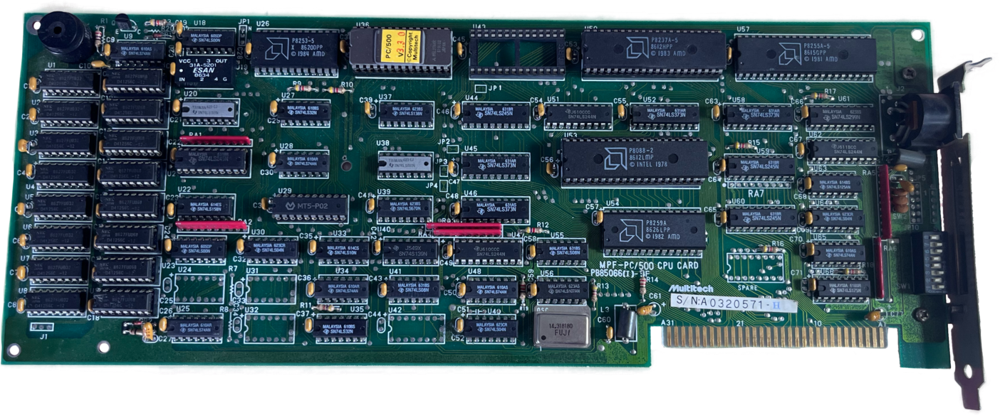
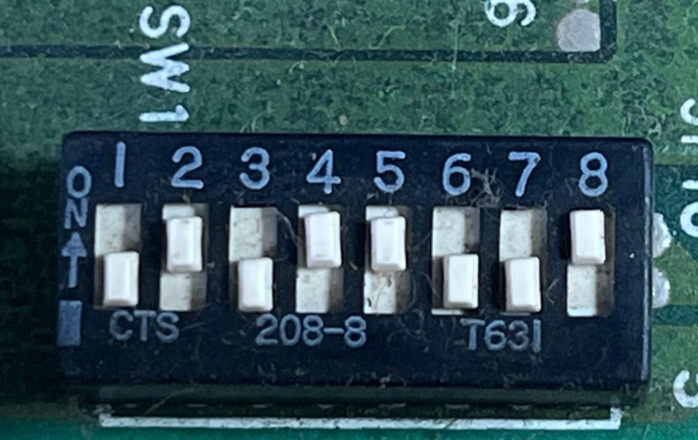

# MPF-PC/500
Multitech's IBM PC clone on an ISA card. 

## Documentation
Pffft, yeah, I wish ...

## [Images](/MPF-PC500/Images)
Photos of my example.

## [BIOS](/MPF-PC500/BIOS)
A dump of the v3.3.0 ROM on my board plus a disassembly to aid understanding how this thing might work.

## Main Components
- ISA edge connector (only +5V and GND connected)
- 5-pin DIN for keyboard
- Intel 8088-2 (8MHz rated)
- Intel 8259A Programmable Interrupt Controller (PIC)
- Intel 8255A-5 Programmable Peripheral Interface (PPI)
- Intel 8237A-5 Direct Memory Access (DMA) Controller
- Intel 8253-5 Programmable Interval Timer (PIT)
- 8KB BIOS ROM (v3.3.0 in my case)
- 14.31818MHz crystal
- 256KB of RAM, expanded to 512KB total
- custom 20-pin MT5-P02 ... MCU, PAL, GAL ... ?
- 8-way DIP switch

## DIP Switch Settings
From the BIOS disassembly it's possible to figure out the purpose of each DIP switch. 

The BIOS reads SW1 through port 60h with port 61h bit 7 set, exactly like the IBM 5150. Switch ON
reads as 0. The board has pads for **SW2 but no switch fitted**. That fits the code, which never
reads memory size from switches and finds it by probing instead.

| Switch | Bit | Meaning | On the board in the photo |
|---|---|---|---|
| 1 | 0 | OFF = diskette drive(s) fitted (boot from A:) | OFF: fitted |
| 2 | 1 | 8087 present (IBM meaning, unused by this BIOS) | ON: none |
| 3–4 | 2–3 | Number of 64 KB blocks to pre-clear (1–4) | 3 OFF, 4 ON: 128 KB |
| 5–6 | 4–5 | Display: ON/ON none or EGA, OFF/ON CGA 40×25, ON/OFF CGA 80×25, OFF/OFF MDA | 5 ON, 6 OFF: CGA 80×25 |
| 7–8 | 6–7 | Number of diskette drives − 1 | 7 OFF, 8 ON: 2 drives |

The setting in the photo (CGA, two drives) matches the Popular 500's stock configuration.
SW1-3/4 only controls the first clear. Real memory size always comes from the probe, so these two
switches matter far less than they do on an IBM PC.

## ISA Backplane
### [ISA Breakout](https://github.com/BrettHallen/ISA_Breakout)
My attempt to design an ISA backplane that could be used as a breakout for testing.
